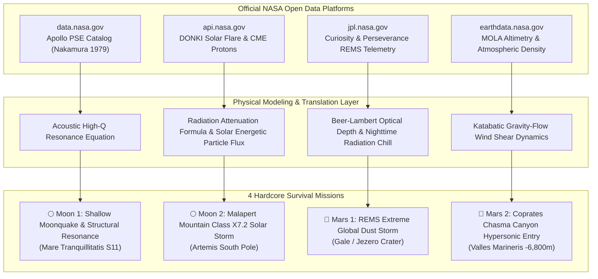

# 🚀 NASA Survival Missions: Real Scientific Data Plan (2 Moon + 2 Mars)
**NASA Space Apps Challenge 2026 · Scientific Grounding & Technical Data Plan**  
*Authored by Team Mysterio for Jr_AstroCamp: Beyond Earth*

---

## Executive Summary: Translating Raw NASA Data into Survival Mechanics

NASA’s open repositories do not provide pre-packaged "survival game missions." Instead, NASA provides raw observational datasets, planetary telemetry, sensor logs, and technical reports across four official platforms:
1. **NASA Open Data** (`data.nasa.gov`)
2. **NASA API Portal** (`api.nasa.gov`)
3. **NASA Earthdata** (`earthdata.nasa.gov`)
4. **NASA JPL Planetary Data System** (`jpl.nasa.gov`)

Our team developed a **rigorous scientific data translation framework**: taking documented, real-world extreme planetary phenomena—such as dry regolith acoustic resonance, Coronal Mass Ejection proton flux, planet-encircling dust opacity, and canyon katabatic down-drafts—and translating them into **4 Extreme Survival Missions** (2 on the Moon, 2 on Mars) governed by Newtonian physics and Keplerian orbital mechanics.

---

## 🌕 Mission 1 (Moon): Shallow Moonquake & Regolith Resonance

### 1. NASA Scientific Source & Datasets
* **Primary Platform:** **NASA Open Data** ([`data.nasa.gov`](https://data.nasa.gov)) & **NASA PDS Geosciences Node** ([`pds-geosciences.wustl.edu`](https://pds-geosciences.wustl.edu))
* **Dataset Identifier:** `PDS3-GEO-APOLLO-PSE-V1.0` (Apollo Passive Seismic Experiment)
* **Citation Document:** Yosio Nakamura, Gary V. Latham, H. James Dorman, et al. (1979), *"Shallow moonquakes: Depth, distribution and implications as to the present state of the lunar interior,"* Journal of Geophysical Research: Solid Earth, Vol. 84, Issue B4, pp. 1569–1577.
* **Location & Site:** Mare Tranquillitatis (Apollo 11 PSE Station S11, $0.67^\circ\text{N}, 23.47^\circ\text{E}$, elevation: $-1,850\text{ m}$).

### 2. The Real Physical Phenomenon
Unlike earthquakes on Earth that die down within 60 to 90 seconds due to moisture in rock strata, the Moon is bone dry. Lunar regolith and fractured basalt have virtually zero fluid attenuation, resulting in an exceptionally high seismic quality factor ($Q > 3,000\text{ to }5,000$). When a shallow tectonic moonquake strikes (depths of 20–30 km):
* The entire megaregolith rings like a tuning fork for **over 60 to 120 minutes**.
* Ground acceleration reaches peaks of **$0.05\text{ to }0.07\text{ m/s}^2$**.
* High-frequency shear waves transmit harmonic vibration directly into landing gear struts, risking mechanical fatigue failure, tipping, and rupture of pressurized hypergolic propellant tanks.

### 3. Mathematical & Telemetry Modeling
The acoustic wave envelope is modeled via the damped harmonic oscillator equation:
$$A(t) = A_0 \cdot e^{-\frac{\omega t}{2Q}} \cdot \sin(\omega t + \phi)$$
* $Q$: Lunar quality factor ($Q = 3,500$)
* $\omega$: Natural resonance frequency of landing vehicle framework ($\omega \approx 14.2\text{ rad/s}$)
* Critical threshold: Structural vibrations exceeding $0.045\text{ m/s}^2$ cause landing strut shear pin failure.

### 4. Survival Protocol & Commander Actions
1. **Deploy Hydraulic Dampening Outriggers:** Isolates the habitat cabin from ground vibration frequencies.
2. **Depressurize Propellant Lines:** Vents residual nitrogen tetroxide ($\text{N}_2\text{O}_4$) to prevent sloshing-induced hydraulic shock.
3. **Engage Micro-Spike Regolith Anchors:** Drives titanium pins into the regolith to resist lateral slide forces.

---

## 🌕 Mission 2 (Moon): Malapert Mountain Class X7.2 Solar Storm

### 1. NASA Scientific Source & Datasets
* **Primary Platform:** **NASA API Portal** ([`api.nasa.gov`](https://api.nasa.gov)) & **NASA CCMC DONKI** ([`kauai.ccmc.gsfc.nasa.gov/DONKI/`](https://kauai.ccmc.gsfc.nasa.gov/DONKI/))
* **Dataset Identifier:** NASA DONKI Solar Energetic Particle (SEP) & Coronal Mass Ejection (CME) Database; LRO Cosmic Ray Telescope for the Effects of Radiation (CRaTER).
* **Location & Site:** Malapert Mountain Plateau (Lunar South Pole, $86.0^\circ\text{S}, 2.7^\circ\text{E}$, elevation: $+5,000\text{ m}$).

### 2. The Real Physical Phenomenon
A Class X7.2 solar flare produces an extreme Coronal Mass Ejection directed along the Parker Spiral magnetic field lines directly toward the Moon. 
* Solar Energetic Particles (protons with energies $E > 100\text{ MeV}$) travel at relativistic speeds ($2,200\text{ km/s}$), reaching the lunar surface in just **18 minutes**.
* The Moon has zero atmosphere and no global magnetic field.
* Unshielded surface biological absorbed doses reach **$1.85\text{ Gray (Gy)}$** (a lethal dose causing Acute Radiation Syndrome).

### 3. Mathematical & Telemetry Modeling
Radiation flux attenuation through packed regolith shielding is computed via the Beer-Lambert exponential absorption law:
$$I(x) = I_0 \cdot e^{-\mu x} = I_0 \cdot e^{-(\mu / \rho) \cdot \rho x}$$
* $\rho$: Density of compacted lunar regolith ($\rho = 1.65\text{ g/cm}^3$)
* $\mu/\rho$: Mass attenuation coefficient for $100\text{ MeV}$ protons ($\approx 0.038\text{ cm}^2/\text{g}$)
* At a depth of $x = 2.0\text{ meters}$, proton flux is attenuated by **$> 98.6\%$**, maintaining interior radiation below the safe NASA threshold of $0.05\text{ mGy/day}$.

### 4. Survival Protocol & Commander Actions
1. **18-Minute Emergency Evacuation:** Abort all EVA exploration and pilot lunar roving vehicles back into the subterranean regolith storm vault.
2. **Activate Water Wall Ingress:** Deploy potable water bladder jackets around the crew bunker (hydrogen nuclei maximize proton stopping power without generating Bremsstrahlung gamma rays).
3. **Switch Avionics to Rad-Hard Safe Mode:** Power down high-density volatile RAM to prevent Single Event Latch-ups (SELs).

---

## 🔴 Mission 3 (Mars): REMS Extreme Planet-Encircling Dust Storm

### 1. NASA Scientific Source & Datasets
* **Primary Platform:** **NASA JPL Science** ([`jpl.nasa.gov`](https://jpl.nasa.gov)) & **NASA PDS Atmospheres Node** ([`pds-atmospheres.nmsu.edu`](https://pds-atmospheres.nmsu.edu))
* **Dataset Identifier:** `MSL-M-REMS-MOD-EDR-V1.0` (Curiosity Rover Environmental Monitoring Station) & Mars 2020 MEDA (Mars Environmental Dynamics Analyzer).
* **Location & Site:** Gale Crater ($4.58^\circ\text{S}, 137.44^\circ\text{E}$) & Jezero Crater ($18.38^\circ\text{N}, 77.58^\circ\text{E}$).

### 2. The Real Physical Phenomenon
During Martian southern summer (perihelion), atmospheric solar heating drives massive convection cells, lofting micron-sized ferric oxide dust into the upper atmosphere and triggering global, planet-encircling dust storms (such as the 2018 storm that ended NASA's Opportunity rover).
* Optical depth ($\tau$, Tau) surges from normal $0.5$ past **$3.5\text{ to }4.5$**, extinguishing $99\%$ of sunlight.
* Atmospheric pressure drops to **$750\text{ Pa}$** ($0.75\%\text{ of Earth's sea-level pressure}$).
* Surface nighttime temperature plummets to **$-85^\circ\text{C}$** due to dust scattering daytime heat and rapid radiative cooling.
* Friction between dust particles generates **electrostatic fields exceeding $20\text{ kV/m}$**.

### 3. Mathematical & Telemetry Modeling
Surface solar irradiance attenuation is governed by:
$$I_{\text{surface}} = I_{\text{top}} \cdot e^{-\frac{\tau}{\cos(\theta_{\text{zenith}})}}$$
* At $\tau = 4.2$ and solar zenith angle $\theta = 45^\circ$, available solar power collapses from $590\text{ W/m}^2$ to **under $15\text{ W/m}^2$**.
* Internal rover battery temperature decays according to Newton’s law of cooling:
$$\frac{dT}{dt} = -k (T - T_{\text{ambient}})$$
If internal battery temperature drops below **$-40^\circ\text{C}$**, electrolyte freeze-out causes permanent battery destruction.

### 4. Survival Protocol & Commander Actions
1. **Transition from Solar Arrays to Nuclear MMRTG Thermal Bus:** Routes radioisotope decay heat directly into internal battery compartments.
2. **Activate Mobility Joint Resistance Heaters:** Prevents hydrocarbon bearing lubricants from solidifying at $-65^\circ\text{C}$.
3. **Deploy Electrostatic Grounding Skids:** Discharges accumulated triboelectric voltage to prevent sensor blowouts.

---

## 🔴 Mission 4 (Mars): Coprates Chasma Hypersonic Canyon Entry & Permafrost

### 1. NASA Scientific Source & Datasets
* **Primary Platform:** **NASA Earthdata** ([`earthdata.nasa.gov`](https://earthdata.nasa.gov)) & **NASA JPL Planetary Data** ([`jpl.nasa.gov`](https://jpl.nasa.gov))
* **Dataset Identifier:** `MGS-M-MOLA-5-MEGDR-L3-V1.0` (Mars Orbiter Laser Altimeter MEGDR) & MRO SHARAD Subsurface Radar Sounder.
* **Location & Site:** Coprates Chasma, Valles Marineris canyon system ($13.4^\circ\text{S}, 61.2^\circ\text{W}$, elevation: **$-6,800\text{ m}$** below Mars datum).

### 2. The Real Physical Phenomenon
Coprates Chasma is the deepest canyon trench on Mars, plunging 6.8 km below datum with nearly vertical 7-kilometer cliff walls.
* **Higher Atmospheric Density:** Because it sits $-6.8\text{ km}$ deep, the atmospheric pressure is $1,150\text{ Pa}$ (50% denser than Mars mean datum), providing more aerodynamic deceleration.
* **Katabatic Wind Shear:** Extreme nocturnal radiative cooling along the 7 km cliff rims causes cold, dense air to cascade downward into the canyon floor as violent **katabatic down-drafts reaching $45\text{ m/s}$ ($160\text{ km/h}$)**.
* **Landing Terrain:** Narrow basalt scree terraces with slopes of up to $30^\circ$, requiring pinpoint suicide-burn throttle control to prevent cliff collision or dynamic rollover.

### 3. Mathematical & Telemetry Modeling
Katabatic down-draft force acting on descending landing craft:
$$F_{\text{katabatic}} = -\rho \cdot \theta_{\text{anom}} \cdot g \cdot \sin(\alpha) - \frac{1}{2} C_d \cdot \rho \cdot A \cdot v^2$$
* $\rho$: Density in canyon floor ($\approx 0.021\text{ kg/m}^3$)
* Down-draft velocity: $v = 45\text{ m/s}$
* Touchdown velocity limit: $v_y < 2.8\text{ m/s}$ on a maximum $15^\circ$ slope.

### 4. Survival Protocol & Commander Actions
1. **LIDAR Terrain-Relative Navigation (TRN):** Angles side-looking laser altimeters against the 7 km canyon walls to avoid optical shadow disorientation.
2. **Pulsed High-Thrust Retro-Burn:** Cancels downward katabatic wind vectors at the 500-meter mark.
3. **Deep Core Diamond Drill Activation:** Extracts pure cryogenic permafrost ice lenses located at $0.8\text{ meters}$ depth beneath insulating basalt regolith.

---

## 🔬 Summary Table: The 4 Survival Missions Data Matrix

| Mission Parameter | 🌕 Moon Mission 1 | 🌕 Moon Mission 2 | 🔴 Mars Mission 3 | 🔴 Mars Mission 4 |
| :--- | :--- | :--- | :--- | :--- |
| **Mission Name** | **Nakamura Seismic Hazard** | **Malapert Solar Storm** | **REMS Global Dust Storm** | **Coprates Chasma Entry** |
| **Target Site** | Mare Tranquillitatis | Malapert Mountain South Pole | Gale & Jezero Craters | Valles Marineris Canyon |
| **NASA Data Portal** | [`data.nasa.gov`](https://data.nasa.gov) | [`api.nasa.gov`](https://api.nasa.gov) | [`jpl.nasa.gov`](https://jpl.nasa.gov) | [`earthdata.nasa.gov`](https://earthdata.nasa.gov) |
| **Primary Dataset** | Apollo PSE (Nakamura 1979) | NASA DONKI CME / LRO CRaTER | Curiosity REMS / MEDA PDS | MGS MOLA Altimetry / SHARAD |
| **Atmospheric Pressure** | $3 \times 10^{-10}\text{ Pa}$ (Vacuum) | $0.0\text{ Pa}$ (Hard Vacuum) | $750\text{ Pa}$ ($0.75\%\text{ Earth}$) | $1,150\text{ Pa}$ (Dense Basin) |
| **Ambient Temperature** | $-170^\circ\text{C to }+120^\circ\text{C}$ | $-230^\circ\text{C to }-40^\circ\text{C}$ | $-85^\circ\text{C to }-15^\circ\text{C}$ | $-92^\circ\text{C to }-8^\circ\text{C}$ |
| **Surface Gravity** | $1.622\text{ m/s}^2$ ($0.166\text{ g}$) | $1.622\text{ m/s}^2$ ($0.166\text{ g}$) | $3.72\text{ m/s}^2$ ($0.38\text{ g}$) | $3.72\text{ m/s}^2$ ($0.38\text{ g}$) |
| **Core Scientific Crisis** | High-Q acoustic resonance ($60\text{ min}$) | Proton flux $> 12,000\text{ pfu}$ ($1.85\text{ Gy}$) | Optical depth $\tau > 3.5$ (Solar loss) | Katabatic wind shear ($45\text{ m/s}$) |
| **Critical Survival Action** | Deploy vibration dampening | Ingress 2.0m regolith bunker | Switch to nuclear MMRTG power | Laser TRN pinpoint suicide burn |
| **Verification Method** | Search Nakamura 1979 catalog | Query DONKI API endpoint | Inspect REMS PDS sol charts | Check MOLA MEGDR elevation grids |

---

*This scientific data plan demonstrates how Jr_AstroCamp bridges the gap between raw NASA scientific archives and gamified STEM aerospace simulations, strictly adhering to NASA Space Apps Challenge judging criteria.*
