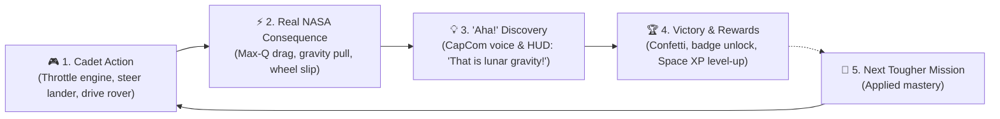

# 🚀 Jr_AstroCamp: Learn-Through-Gameplay UI Redesign Plan
### *Transforming Complex Aerospace Telemetry into an Addictive, Inspiring Space Game Where Junior Cadets (Ages 10–14) Learn NASA Science Naturally Through Play*

---

## 🎮 Executive Vision: "Stealth Learning Through Gameplay"

> **The Big Shift:**  
> Kids do not want to read an aerospace encyclopedia or struggle with Julian Date ephemeris tables (`JD 2460621`). **They want to fly rockets, land on the Moon, dodge Martian dust storms, and drive rovers.**
>
> The redesigned Jr_AstroCamp UI is built on a **Game-First Pedagogy**:
> - **The student thinks:** *"I am playing an awesome space flight and base survival game!"*
> - **In reality:** Every button they press, every engine throttle, every solar panel angle, and every rover wheel turn is teaching them **real NASA physics, orbital mechanics, human life support stoichiometry (BVAD), and planetary geology.**

---

## 🖼️ Visual Architecture & Flow Diagrams (JPG Gallery)

The structural diagrams have been rendered in high resolution and saved into [`structure_diagrams/`](../structure_diagrams):

1. **`01_project_structure_overview.jpg`**: Full system & codebase tree (Web React 19 + Three.js + Phaser 2D + Python 60 FPS + NASA open data).
2. **`02_learn_through_gameplay_loop.jpg`**: The Gamified "Learn While Playing" loop (Action -> Real NASA physics consequence -> Science revelation -> Badge reward).
3. **`03_junior_cadet_ui_flow.jpg`**: The 4-Pillar UI navigation & screen flow for junior cadets.
4. **`04_gameplay_mechanics_vs_nasa_science.jpg`**: Game mechanics paired with authentic NASA concepts (Launch, Docking, Lunar Landing, Rover Driving, ECLSS Base Survival, Solar System Explorer).

---

## 🕹️ Part 1: The "Learn While Playing" Core Loop



### How Each Game Mechanic Teaches Authentic NASA Science
| Playable Game | What the Junior Student Does (Fun Gameplay) | What They Secretly Learn (NASA Science) |
| :--- | :--- | :--- |
| **🚀 Rocket Launch to Orbit** | Throttling main engines, watching dynamic flame trails, and timing rocket staging. | **Newton's 3rd Law, Aerodynamic Drag, Max-Q Dynamic Pressure**, and atmospheric exit angles. |
| **🛰️ ISS Space Station Docking** | Tapping RCS thrusters to align crosshairs with docking port without bumping. | **Microgravity, Inertia, 6-DOF RCS translations**, and why you cannot "brake" with air in space. |
| **🌕 Apollo Lunar Landing** | Countering gravitational pull with thrusters to touch down softly before fuel hits 0%. | **Lunar Gravity (1/6th g), Thrust-to-Weight Ratio**, Terminal Descent, and Fuel Allocation. |
| **🚜 Mars Rover Ice Prospecting** | Driving over craters, dodging sharp boulders, and drilling for volatile ice cores. | **Regolith Terramechanics, Wheel Slip Ratios**, Polar Cold Traps, and Raman Spectroscopy. |
| **🏗️ Planetary Base Builder** | Placing solar panels, Kilopower reactors, oxygen scrubbers, and salad biodomes. | **NASA BVAD Stoichiometry ($0.84\text{ kg O}_2$/day)**, Sabatier $\text{CO}_2$ Scrubbing, and the **354-hour Lunar Night power crisis**. |
| **🪐 Kids 3D Solar System** | Zooming into 3D planets and dragging the "How Heavy Would I Be?" scale slider. | **Astronomical Units (AU), Orbital Velocity, Surface Gravity Wells**, and Light-Delay Delays. |

---

## 🧭 Part 2: The Redesigned 4-Pillar Junior Navigation

We replace the current 15 top buttons and 30 confusing popups with **4 joyful, kid-friendly pillars**:

```
[ 🚀 Jr_AstroCamp ]   [ 🌟 1. Launchpad ]   [ 🎓 2. Academy ]   [ 🕹️ 3. Simulators ]   [ 🏅 4. Locker ]      [ 🏆 Judge | 👩‍🏫 Teacher ]
```

### Pillar 1: 🌟 Launchpad (The Cadet's Command Deck)
- **Friendly Greeting:** *"Welcome back, Cadet [Callsign]! Ready for your next flight?"*
- **Primary Hero Card (Large & Glowing):**
  - **`[ CONTINUE MISSION: SOL 4 ON THE MOON ▶ ]`**
  - Shows current level, badge progress bar, and immediate next objective.
- **Daily Space Mystery (60-Second Mini-Quiz):**
  - *"Houston Emergency! Dust storm detected on Mars. Do you: [A] Fold Solar Panels, or [B] Fire thrusters?"*
  - Correct choice rewards **+50 Space XP** with a celebratory sound effect.
- **Quick Simulators Carousel:**
  - One-click launch cards with video/3D hover previews for instant play.

### Pillar 2: 🎓 Cadet Academy (Visual Cosmic Trail)
- Built like a **Mario World / Duolingo cosmic journey** across 8 milestone stages.
- Clicking any stage opens a **3-step interactive briefing**:
  1. **Story Comic (1 Min):** 4 colorful comic panels featuring Cadet Maya and Commander Dadu experiencing the challenge.
  2. **Interactive Mini-Challenge (1 Min):** Hands-on slider or puzzle (e.g. adjust Sabatier gas ratio to create water).
  3. **Earn Your Badge!** Confetti burst, CapCom voice cheer, and badge saved to locker.
  - *(Optional bottom pill: "🔬 NASA Engineering Deep Dive" for judges and teachers).*

### Pillar 3: 🕹️ Space Simulators Arcade Hub
- Visual game grid with clear, child-friendly labels:
  - 🌕 *Moon Lander Challenge* (`🟢 Easy Cadet` • `⏱️ 3 Mins`)
  - 🚜 *Mars Rover Ice Expedition* (`🟡 Pilot` • `⏱️ 4 Mins`)
  - 🛰️ *Space Station Docking Master* (`🔴 Commander` • `⏱️ 5 Mins`)
  - 🚀 *Saturn V / SLS Orbit Booster* (`🟢 Easy Cadet` • `⏱️ 3 Mins`)
  - 🪐 *3D Solar System Planetarium (Kids Explorer)* (`🟢 All Ages`)
  - 🕳️ *Black Hole Event Horizon Probe* (`🟡 Pilot` • `⏱️ 2 Mins`)

### Pillar 4: 🏅 Astronaut Locker & Graduation
- **Personalized Astronaut License:** Cadet callsign, chosen avatar, completed flight hours, and rank (*"Flight Officer First Class"*).
- **Badge Wall:** 8 glowing mission patches (e.g. *Oxygen Master*, *Lunar Driver*, *Deep Space Navigator*).
- **Printable Vector NASA Diploma:** Instant PDF/PNG download featuring authentic gold astronaut wings, cadet name, and NASA challenge verification seal.

---

## 🎨 Part 3: "Juicy Game Feel" UI Guidelines

To keep young students genuinely satisfied and engaged:
1. **Tactile Feedback:** Every button has hover elevation, mechanical click sounds (`soundFx.playClick`), and subtle glows.
2. **Instant Radio CapCom Audio:** Houston CapCom speaks short, encouraging voice lines (*"All telemetry nominal, Cadet!"*, *"Warning: Battery below 20%, head back to base!"*).
3. **Celebratory Moments:** Completing a mission triggers particle confetti (`canvas-confetti`) and victory chimes.
4. **Never a Dead-End Failure:** Crashing a lander or draining batteries shows a humorous, constructive debrief:
   - *"Ouch! That was a hard landing. On the Moon, gravity doesn't have air to slow you down. Try firing your thruster 50 meters higher!"*
   - Big friendly button: **`[ TRY AGAIN 🔄 ]`**.

---

## 🏗️ Part 4: Technical Refactoring Architecture

Decomposing the monolithic files into clean, maintainable modular layers:

```plaintext
src/
├── app/
│   ├── store.ts                     # Central state (Cadet profile, active route, audio mute)
│   ├── routes.ts                    # 4 routes: 'launchpad', 'academy', 'simulators', 'locker'
│   └── theme.ts                     # Kid-friendly design tokens (colors, radii, animations)
│
├── components/
│   ├── common/                      # Reusable UI primitives
│   │   ├── SpaceButton.tsx          # Tactile button with sound & glow
│   │   ├── BadgeCard.tsx            # Gamified badge display
│   │   ├── ConfettiCelebration.tsx  # Victory particle effect
│   │   └── AhaDiscoveryPopup.tsx    # In-game micro-learning popup
│   │
│   ├── onboarding/                  # 15-second first-visit setup
│   │   ├── CadetOnboardingModal.tsx # Callsign picker + avatar selection
│   │   └── AvatarCard.tsx
│   │
│   ├── launchpad/                   # Home Screen
│   │   ├── HeroMissionCard.tsx      # Main CTA banner
│   │   ├── DailyChallengeCard.tsx   # 60-second quiz
│   │   └── QuickSimCarousel.tsx     # Game preview slider
│   │
│   ├── academy/                     # Gamified Cosmic Trail
│   │   ├── CosmicJourneyMap.tsx     # Mario/Duolingo-style progression map
│   │   ├── LevelNode.tsx            # Animated level pin
│   │   └── LevelBriefingModal.tsx   # Comic -> Mini-Challenge -> Badge reward
│   │
│   ├── simulators/                  # Arcade Hub
│   │   ├── SimulatorsArcadeGrid.tsx # Filterable game cards
│   │   └── GameRunnerModal.tsx      # Unified 2D/3D simulator viewport
│   │
│   └── orrery/                      # Cleaned-up 3D Solar System
│       ├── KidsOrreryCanvas.tsx     # Simplified, smooth Three.js planetarium
│       └── PlanetFunFactsCard.tsx   # "How much would you weigh here?" card
```

---

## 📋 Part 5: Implementation Phases

| Phase | Focus Area | Deliverables |
| :--- | :--- | :--- |
| **Phase 1** | **Cadet Onboarding & Launchpad** | Build `CadetOnboardingModal.tsx` (callsign & avatar) + new Home Launchpad with giant **`[ START TRAINING 🚀 ]`** CTA. |
| **Phase 2** | **4-Pillar Top Bar** | Replace 15 navbar buttons with the 4 pillars + discreet top-right Judge & Teacher buttons. |
| **Phase 3** | **Gamified Cosmic Academy Trail** | Build `CosmicJourneyMap.tsx` with sequential level unlocks and the Comic -> Challenge -> Badge loop. |
| **Phase 4** | **Simulators Arcade Hub** | Consolidate all mini-games into `SimulatorsArcadeGrid.tsx` with kid-friendly game cards. |
| **Phase 5** | **Juicy Game Feel & Sound** | Integrate celebratory confetti, CapCom radio encouragement, and interactive "Aha!" learning popups. |
