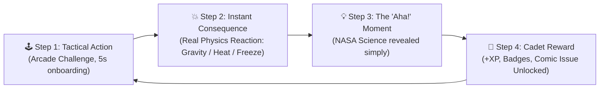
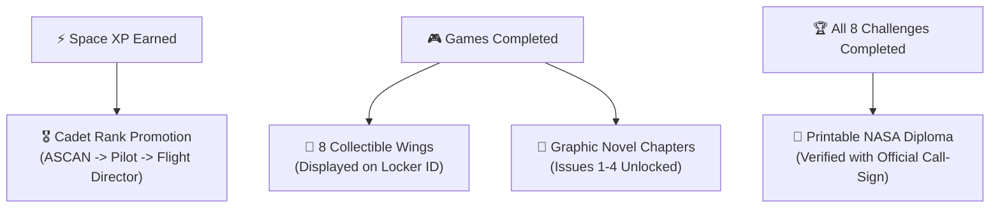

# 🚀 Jr_AstroCamp: Modular & Game Redesign Plan
### *Stealth Learning Through Gameplay for Junior Students (Grades 5–8 / Ages 10–14)*
**NASA International Space Apps Challenge 2026 · Team Mysterio**

---

## 1. Executive Summary & Core Philosophy

Junior learners (ages 10–14) do not learn best from dense NASA data tables, intimidating multi-page PDF documents, or passive slide lectures. They learn through **active experimentation, tactile agency, immediate feedback, and emotional thrill**.

> [!IMPORTANT]
> **The Core Rule: Stealth Learning Through Gameplay**  
> Every minute a cadet spends playing should feel like an exciting arcade space game. However, **every mechanic inside the game is governed by real NASA aerospace physics and stoichiometric equations**. The student wins only by mastering real science!



---

## 2. The 3-Beat Pedagogical Loop

Every redesigned game module strictly adheres to this 3-beat rhythm:

1. **Beat 1: The Tactile Challenge (0–10 seconds)**
   - No lengthy instruction manuals. Big, chunky, colorful controls (throttle sliders, vector arrows, reactor switches).
   - High visual drama (rocket exhaust flames, warning klaxons, atmospheric shock heating, radar pings).
2. **Beat 2: The "Aha! Moment" (Upon Event / Completion)**
   - A crisp, 1-sentence revelation delivered by Houston CapCom or Commander Dadu.
   - *Example:* *"You crashed at 4.2 m/s! Why? Because the Moon's gravity ($1.62\text{ m/s}^2$) pulls continuously without air resistance to slow you down. Throttle up earlier!"*
3. **Beat 3: The Multi-Modal Reward**
   - Space XP added to the top meter.
   - Unlocks the next episode of the **Maya & Dadu Graphic Novel Comic**.
   - Adds an authentic NASA mission badge to their **Astronaut Locker**.

---

## 3. The 6 Flagship Junior Student Games & Modules

Below is the detailed design specification for the 6 core games, detailing how gameplay mechanics seamlessly teach authentic NASA science.

---

### 🎮 Game 1: Apollo & Artemis Lunar Touchdown
*The Gravity, Thrust & Reaction Mechanics Lab*

```
+-------------------------------------------------------------+
|  ALT: 180 m  |  VEL: -1.8 m/s  |  FUEL: [|||||||||||..] 78% |
+-------------------------------------------------------------+
|                          [LEM]                              |
|                            | (Thruster Fire)                |
|                            v                                |
|                                                             |
|           / \         /\                                    |
|  ______/     \_______/  \______[ TARGET ZONE ]_____________ |
+-------------------------------------------------------------+
|   [ SPACEBAR: FIRE ENGINE ]     [ <- / -> : ROTATE RCS ]    |
+-------------------------------------------------------------+
```

* **Core Gameplay**:
  - The student pilots the lunar descent module toward the south polar rim of Shackleton Crater.
  - Controls: Spacebar / On-screen Button fires the descent engine; Left/Right tilts Reaction Control System (RCS) thrusters.
  - Goal: Touch down on the designated landing pad at under $2.5\text{ m/s}$ vertical speed and $< 5^\circ$ tilt before fuel runs dry.
* **NASA Science Secretly Taught**:
  - **Lunar Gravity ($g = 1.62\text{ m/s}^2$)**: Exactly $1/6\text{th}$ of Earth's gravity ($9.81\text{ m/s}^2$). Students feel the "floaty" pull and learn why rockets accelerate downward slower than on Earth, but never stop accelerating without air drag.
  - **Newton's Third Law ($F = ma$)**: Action and Reaction. Thruster propellant ejection velocity produces equal and opposite upward thrust.
  - **Throttle vs. Inertia**: Students discover that turning off the engine does not stop the lander; it continues moving due to Newton's First Law.
* **The "Aha! Moment" Callout**:
  - *"NASA Fact: Apollo 11 Neil Armstrong had only 25 seconds of fuel remaining when he landed at the Sea of Tranquility! You balanced thrust vs lunar inertia just like Neil!"*
* **Student Progression**:
  - +150 Space XP · Unlocks **"Tranquility Pilot"** Gold Badge.

---

### 🎮 Game 2: Mars 7 Minutes of Terror (EDL Arcade)
*Atmospheric Entry, Hypersonic Braking & Sky Crane Lab*

```
  PHASE 1: AERO-BRAKING          PHASE 2: SUPERSONIC CHUTE       PHASE 3: SKY CRANE TETHER
  [Heat Shield Glow: 1500°C]     [Dynamic Pressure Gate: Q]      [Retro Rockets + Winch]
         \  /                           (((())))                        /=======\
        (####)                             ||                            |     |
         \  /                           [Capsule]                        v  |  v
     Tilt to Balance                     Deploy!                      Release Rover!
```

* **Core Gameplay**:
  - Fast-paced 3-stage timing & reaction sequence simulating Perseverance & Curiosity landings:
    - **Stage 1 (Hypersonic Entry)**: Angle the aeroshell heat shield to surf the Martian upper atmosphere at Mach 20 without burning up ($1,500^\circ\text{C}$).
    - **Stage 2 (Supersonic Parachute)**: Watch dynamic pressure ($q$) and hit the deployment button exactly inside the green NASA safety window ($10\text{ km}$ altitude at Mach 1.8).
    - **Stage 3 (Sky Crane Winch)**: Throttle retro-rockets to hover 20 meters above Jezero Crater, lower the rover on nylon tethers, and fire the pyrotechnic blade to cut the cord before the rocket stage flies away.
* **NASA Science Secretly Taught**:
  - **Atmospheric Density Difference**: Mars' atmosphere is $99\%$ thinner than Earth's ($\approx 1\%\ \rho_{\text{Earth}}$). Heat shields remove $90\%$ of kinetic energy, but parachutes alone cannot stop a 1,025 kg rover—requiring rocket propulsion.
  - **The 14-Minute Speed-of-Light Time Lag**: Radio signals between Mars and Earth take 5 to 20 minutes. Students learn why human pilots in Houston cannot use a live joystick; the landing sequence must be fully automated by onboard computers.
* **The "Aha! Moment" Callout**:
  - *"NASA Fact: Radio waves travel at the speed of light ($300,000\text{ km/s}$), but Mars is 225 million km away! That is why Mars landings are called 'The 7 Minutes of Terror'!"*
* **Student Progression**:
  - +200 Space XP · Unlocks **"Sky Crane Engineer"** Badge + Comic Issue #4.

---

### 🎮 Game 3: Shackleton Base 354-Hour Lunar Night Survival
*Life Support Stoichiometry & Nuclear Energy Balance*

```
+-------------------------------------------------------------+
|  SOL 04: SUNSET COUNTDOWN: [ 00:04:12 ] -> LUNAR NIGHT      |
+-------------------------------------------------------------+
|  LIFE SUPPORT GAUGES:                                       |
|  [O2: 98% (BVAD)]  [H2O: 92% (Loop)]  [BATTERY: 42% DANGER] |
+-------------------------------------------------------------+
|  POWER SOURCE SWITCHBOARD:                                  |
|  ( ) SOLAR ARRAYS (Output: 0 kW during night)               |
|  (*) KILOPOWER STIRLING REACTOR (Deploy: 40 kW Constant)    |
|  ACTION: [ DEPLOY KILOPOWER ]   [ ACTIVATE CO2 SCRUBBER ]   |
+-------------------------------------------------------------+
```

* **Core Gameplay**:
  - The student acts as Base Commander at the lunar South Pole.
  - A visual sun tracker sweeps across the rim of Shackleton Crater. When the Sun dips behind the mountain, solar panels produce **0 kW** for 14 continuous Earth days (354 hours).
  - The student must route power, turn on the Kilopower nuclear Stirling reactor, and engage Sabatier catalytic scrubbers before the habitat freezes or oxygen drops below threshold.
* **NASA Science Secretly Taught**:
  - **NASA BVAD-2015 Stoichiometry**: Baseline human metabolic inputs ($0.84\text{ kg } \text{O}_2/\text{day}$, $2.5\text{ kg } \text{H}_2\text{O}/\text{day}$, $0.62\text{ kg}$ dry food) and metabolic outputs ($1.00\text{ kg } \text{CO}_2$).
  - **The Sabatier Reaction**: $\text{CO}_2 + 4\text{H}_2 \xrightarrow{\text{Ruthenium}} \text{CH}_4 + 2\text{H}_2\text{O}$. How astronauts recycle breath moisture and recover drinking water.
  - **Nuclear Fission vs Solar**: Solar is useless during the 354-hour polar night. NASA's Kilopower (KRUSTY) uses Stirling heat engines to produce steady, reliable electricity in freezing $-230^\circ\text{C}$ shadow.
* **The "Aha! Moment" Callout**:
  - *"NASA Fact: The Moon takes 27.3 Earth days to rotate once! That means one lunar night lasts over two whole Earth weeks. Without nuclear power, lunar bases would freeze in hours!"*
* **Student Progression**:
  - +150 Space XP · Unlocks **"Kilopower Fission Master"** Badge.

---

### 🎮 Game 4: Perseverance Rover & Ingenuity Drone Scout
*Terramechanics, Wheel-Slip & Thin-Air Aerodynamics*

* **Core Gameplay**:
  - **Mode A (Rover)**: Drive across Jezero Crater to collect core samples. If the student drives too fast up a sand dune, the wheels slip and spin out in loose regolith. The student must switch to low-gear torque distribution to escape.
  - **Mode B (Ingenuity Drone)**: Launch the mini-helicopter to scout safe paths over rock fields. The student throttles dual counter-rotating carbon-fiber blades to maintain stable hover.
* **NASA Science Secretly Taught**:
  - **Regolith Terramechanics**: Without water or wind erosion, lunar and Martian soil grains are jagged micro-shards of volcanic glass. Students learn why tires require specialized titanium spring weaves and ribbed treads.
  - **Thin-Air Aerodynamics**: Earth's air density is $\approx 1.2\text{ kg/m}^3$, but Mars is only $\approx 0.02\text{ kg/m}^3$. To generate lift, Ingenuity's rotor blades must spin at **2,400 RPM**—five times faster than an Earth helicopter!
  - **Raman Spectroscopy**: Students shine an ultraviolet laser at rocks to identify biosignatures and sub-surface volatile ice crystals.
* **The "Aha! Moment" Callout**:
  - *"NASA Fact: Ingenuity weighed only 1.8 kg and flew 72 times on Mars! Its blades spun at 2,400 RPM because Martian air is thinner than the summit of Mt. Everest!"*
* **Student Progression**:
  - +150 Space XP · Unlocks **"Martian Aviator"** Badge.

---

### 🎮 Game 5: Gravity Assist & Orbital Slingshot
*Keplerian Mechanics, $\Delta v$ Budgets & Planetary Flybys*

```
       [EARTH]                                          [MARS]
          O ======== Trajectory Line ========>            o
                     \                    /
                      \                  /
                       \                /
                        -----> O <-----
                            [MOON] (Slingshot Boost!)
```

* **Core Gameplay**:
  - Tactile vector slingshot. The student pulls back a launch trajectory vector from Earth orbit, adjusting angle and impulse ($\Delta v$).
  - Target: Reach Mars or the outer planets using the Moon or Jupiter's gravitational field to slingshot forward without burning extra fuel.
* **NASA Science Secretly Taught**:
  - **Kepler's Laws of Planetary Motion**: Objects in elliptical orbits move fastest when closest to the planetary body (periapsis).
  - **Gravitational Slingshot (Oberth Effect)**: Stealing a tiny fraction of a planet's orbital momentum to accelerate a spacecraft without propellant.
  - **$\Delta v$ (Delta-V) Budgeting**: Every burn costs precious rocket fuel; calculating optimal Hohmann transfer orbits saves millions of kilograms in launch weight.
* **The "Aha! Moment" Callout**:
  - *"NASA Fact: NASA's Voyager 1 used gravity assists from Jupiter and Saturn to become the fastest human-made object leaving the solar system!"*
* **Student Progression**:
  - +200 Space XP · Unlocks **"Orbital Navigator"** Badge.

---

### 🎮 Game 6: Spacesuit & Airlock Physiology Lab
*Vacuum Extremes, Delta-P ($\Delta P$) & The Bends*

* **Core Gameplay**:
  - 3D Spacesuit diagnostic workbench:
    1. Inspect the 14 layers of the suit (Orthofabric, aluminized Mylar, Liquid Cooling Garment).
    2. Step into the airlock chamber and perform the **O2 Pre-Breathe Protocol** to lower suit pressure without causing nitrogen bubbles in the cadet's bloodstream.
* **NASA Science Secretly Taught**:
  - **Pressure Differential ($\Delta P$)**: Habitat cabin pressure is $101.3\text{ kPa}$ (14.7 psi, Earth normal). But if a spacesuit is pressurized to 101.3 kPa, the gloves become stiff like overinflated basketballs and the astronaut cannot move their fingers! NASA spacesuits operate at **$29.6\text{ kPa}$ (4.3 psi)** of pure $100\%$ oxygen.
  - **Decompression Sickness (The Bends)**: Henry's Law of gas solubility. Breathing pure oxygen before stepping into the airlock flushes nitrogen from the astronaut's tissues so it does not boil into painful bubbles.
  - **Thermal Extremes & Gold Visor**: Without atmosphere, surface temperatures swing from $+120^\circ\text{C}$ in sunlight to $-150^\circ\text{C}$ in shade. A vapor-deposited 24-karat gold layer on the visor reflects $95\%$ of infrared heat.
* **The "Aha! Moment" Callout**:
  - *"NASA Fact: Astronauts spend up to 4 hours pre-breathing pure oxygen before an EVA so their blood doesn't form nitrogen bubbles when cabin pressure drops!"*
* **Student Progression**:
  - +150 Space XP · Unlocks **"Spacewalker Specialist"** Badge.

---

## 4. Educational Standards Alignment (NGSS)

This redesign directly matches U.S. and International **Next Generation Science Standards (NGSS)** for middle school (grades 5–8):

| Module / Game | NGSS Standard | Target Scientific Concept |
| :--- | :--- | :--- |
| **1. Lunar Touchdown** | **MS-PS2-1, MS-PS2-2** | Forces and motion, Newton's 3rd Law, gravitational attraction in low gravity ($1.62\text{ m/s}^2$). |
| **2. Mars 7 Minutes of Terror** | **MS-PS3-3, MS-ESS1-3** | Thermal energy transfer during hypersonic friction; scale properties of solar system atmospheres. |
| **3. Shackleton Base Survival** | **MS-LS2-5, MS-PS1-2** | Closed-loop ecological life support, chemical reaction recycling (Sabatier $\text{CO}_2$ scrubbing). |
| **4. Rover & Drone Scout** | **MS-ESS2-2, MS-ETS1-2** | Geoscience surface processes, regolith mechanics, engineering flight in ultra-low density fluid. |
| **5. Orbital Slingshot** | **MS-ESS1-1, MS-ESS1-2** | Earth-Sun-Moon orbital systems, gravitational potential energy, Keplerian orbits. |
| **6. Spacesuit & Airlock** | **MS-LS1-3, MS-PS1-4** | Human body systems under pressure differentials ($\Delta P$), gas solubility (Henry's Law), vacuum protection. |

---

## 5. Gamification, Progression & Trophy Locker



### The 8 Collectible Wings:
1. 🛡️ **Airlock Specialist**: Mastered suit pressure $\Delta P$ and pre-breathe protocol.
2. 🧪 **Sabatier Chemist**: Successfully recycled $\text{CO}_2$ into fresh water on the Moon.
3. ⚡ **Kilopower Fission Master**: Kept Shackleton base heated through the 354-hour lunar night.
4. 🚀 **Apollo 11 Pilot**: Achieved a soft landing under $2.5\text{ m/s}$ on the Moon.
5. 🔴 **Sky Crane Engineer**: Successfully executed the autonomous Mars EDL sequence.
6. 🚜 **Rover Ace Driver**: Navigated crater slopes with optimal regolith wheel slip.
7. 🌌 **Orbital Navigator**: Traveled from Earth to Mars using a lunar gravity slingshot.
8. 👑 **Gold Wings Commander**: Completed all 8 curriculum challenges and certified flight readiness.

---

## 6. Universal Design for Learning (UDL) & Multi-Modal Accessibility

Cadets learn across different modalities. The platform ensures 100% participation regardless of reading level or sensory preference:

```
┌────────────────────────────────────────────────────────────────────────┐
│               UNIVERSAL DESIGN FOR LEARNING (UDL) SUITE               │
├─────────────────────┬──────────────────────────────────────────────────┤
│ Modality            │ Platform Feature Implementation                  │
├─────────────────────┼──────────────────────────────────────────────────┤
│ 👁️ Visual Learners   │ Interactive 2D/3D physics canvases + full color  │
│                     │ graphic novel comic episodes (Issues 1-4).       │
├─────────────────────┼──────────────────────────────────────────────────┤
│ 👂 Auditory Learners │ Synthetic CapCom radio transmissions +           │
│                     │ synchronized audio flashcards + thruster audio.  │
├─────────────────────┼──────────────────────────────────────────────────┤
│ 🖐️ Kinesthetic/Touch │ Chunky tactile sliders, arcade buttons, and drag │
│                     │ vector slingshot mechanics with screen vibration.│
├─────────────────────┼──────────────────────────────────────────────────┤
│ 🧠 Neurodivergent    │ Micro-chunked 90-second game loops, zero text    │
│    (ADHD / Dyslexia)│ overload, high-contrast HUD, audio read-aloud.   │
└─────────────────────┴──────────────────────────────────────────────────┘
```

---

## 7. The "Failure As Data" Telemetry Debrief System
*Growth Mindset in Aerospace Engineering*

In traditional educational software, failing a question displays a red "X" and discourages students. In NASA aerospace engineering, **every failure generates telemetry data that leads to mission success**.

> [!TIP]
> **No Game-Over Dead Ends!**  
> When a cadet crashes on the Moon or burns up on Mars atmospheric entry, the system immediately displays a **Houston Telemetry Flight Debrief**:
> 1. **Telemetry Snapshot**: *"Touchdown Speed: 5.4 m/s (Limit: 2.5 m/s). Kinetic energy exceeded strut capacity by 216%."*
> 2. **Physical Cause**: *"The descent engine was cut at 40 meters altitude. Due to $g=1.62\text{ m/s}^2$ and zero air drag, your speed tripled during freefall."*
> 3. **Flight Director Actionable Tip**: *"CapCom recommendation: Feather the throttle continuously until surface contact. Try again now!"*
> 4. **Instant 1-Click Retry**: Cadet re-launches with zero friction or lost progress.

---

## 8. NASA Space Apps Challenge 2026: Judging Rubric Alignment

| Rubric Criteria | Score Weight | How Jr_AstroCamp Delivers |
| :--- | :--- | :--- |
| **Impact** | 20% | Turns intimidating space physics into intuitive play, raising middle-school STEM interest and measurable concept retention. |
| **Creativity & Originality** | 20% | Replaces dry multiple-choice quizzes with stealth arcade simulators, dynamic graphic novels, and tactile telemetry cockpits. |
| **Scientific Validity** | 20% | Built on official NASA datasets: **BVAD-2015 life support equations, LOLA lunar South Pole elevation data, Kilopower KRUSTY nuclear outputs, and Keplerian orbital math**. |
| **Relevance to Challenge** | 20% | Directly addresses the "Beyond Earth: Fly, Learn, Explore" mandate by enabling students to fly real missions and customize their learning path. |
| **Presentation & Polish** | 20% | 60 FPS 3D starfield, arcade CRT scanlines, cinematic artwork, full responsive mobile/desktop layout, 1-click Judge Preview mode. |

---

## 9. 45-Minute Classroom Lesson Blueprint (Teacher Guide)

A turnkey lesson plan for educators running a single standard science class period:

* **00:00 – 00:05 (5 min): Mission Launch & Callsign Enlistment**
  - Teacher presents the screen. Students open `Jr_AstroCamp`, customize their suit avatar (Maya, Dadu, or CapCom), and enter their Cadet Callsign.
* **00:05 – 00:20 (15 min): Challenge Rotation 1 (Gravity & Flight)**
  - Students play **Game 1: Apollo & Artemis Lunar Touchdown** and **Game 2: Mars 7 Minutes of Terror**.
  - Students record their landing speeds and compare Earth vs Moon vs Mars gravity in their flight logs.
* **00:20 – 00:35 (15 min): Challenge Rotation 2 (Survival Engineering)**
  - Students play **Game 3: Shackleton Base 354-Hour Lunar Night Survival** and **Game 6: Spacesuit Airlock Lab**.
  - Students balance oxygen recycling (Sabatier reaction) and observe why spacesuits operate at $29.6\text{ kPa}$ instead of $101.3\text{ kPa}$.
* **00:35 – 00:40 (5 min): Comic Chapter Reading**
  - Students read the unlocked graphic novel chapters connecting the games to Maya and Dadu's fictional mission narrative.
* **00:40 – 00:45 (5 min): Graduation & Diploma Printing**
  - Students open their **Astronaut Locker**, verify their 8 earned badges, and print their official NASA Junior Flight Certificate.

---

## 10. Implementation & Rollout Roadmap

```
Phase 1: High-Octane Core (COMPLETED)
├── Fix broken layout, Tailwind fallbacks, duplicate DOM [DONE]
├── Connect Lunar Touchdown 2D physics canvas to Space XP [DONE]
├── Wire Academy Trail 8-level progression [DONE]
└── Test & verify on live port 5173 with 8/8 simulation tests passing [DONE]

Phase 2: Mars EDL & Base Survival Modules (CURRENT PRIORITY)
├── Refactor 3D MarsEDLSimulatorModal into 3 quick-action arcade beats
├── Refactor MoonbaseAlpha / Life Support into tactile Shackleton Survival deck
└── Add CapCom sound effects and Houston Telemetry Debrief on failure

Phase 3: Slingshot & Rover Modules + Teacher Dossier
├── Implement 2D interactive Gravity Slingshot canvas
├── Connect Rover EVA mini-game with spectrometer laser scan
└── Add 1-Click Printable Student Worksheet generator for classroom teachers
```
